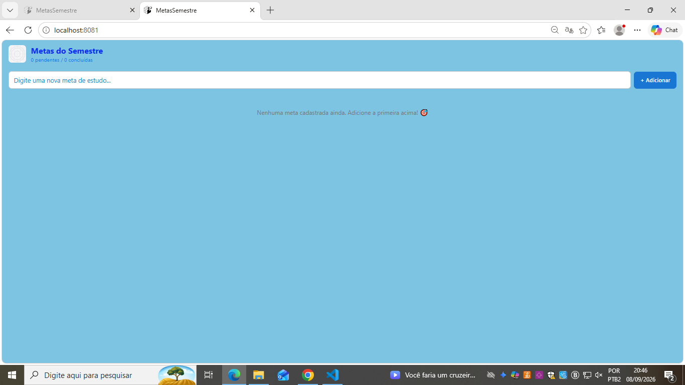
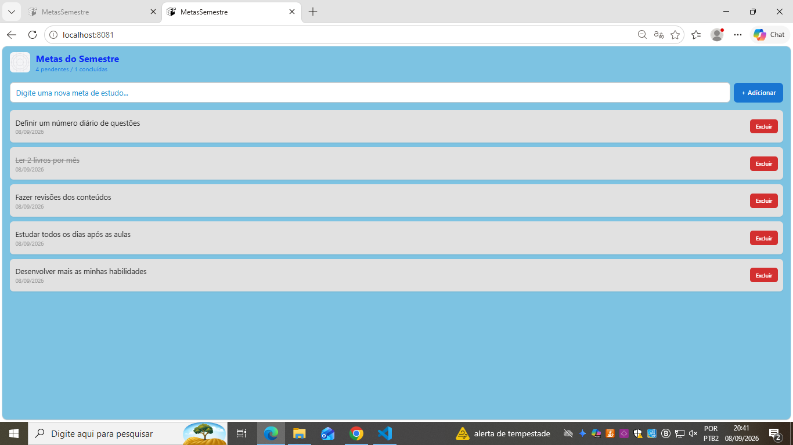
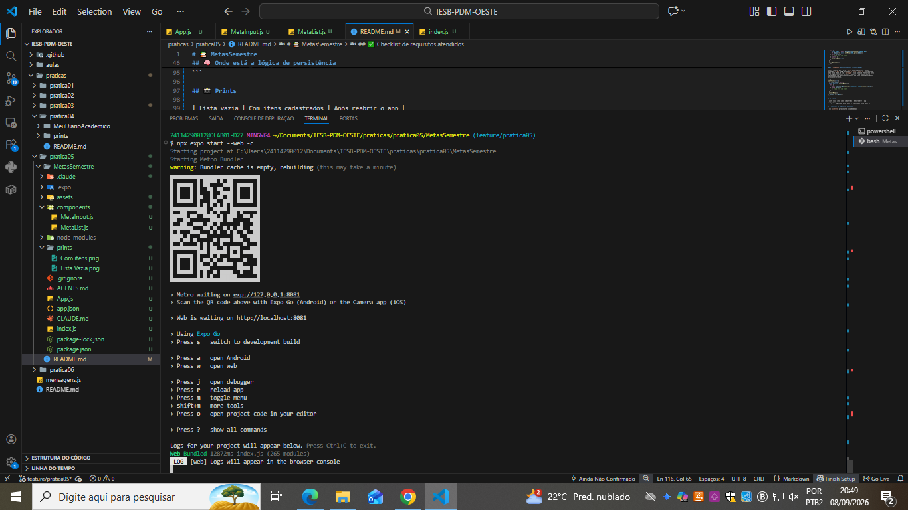

# 📚 MetasSemestre

Aplicativo em React Native (Expo) para cadastro de metas de estudo, com
persistência local usando `AsyncStorage`. Desenvolvido como parte da
prática 05 da disciplina IESB-PDM-OESTE.

## ✨ Funcionalidades

- Cadastrar metas de estudo (com validação de texto vazio)
- Remover metas
- Marcar/desmarcar metas como concluídas (texto riscado)
- Contador de metas pendentes / concluídas no cabeçalho
- Persistência local: as metas sobrevivem ao fechar e reabrir o app

## 🛠️ Tecnologias

- React Native + Expo (`blank` template)
- `useState`, `useEffect`
- `@react-native-async-storage/async-storage`
- `react-native-safe-area-context`
- Componentização (`Pressable`, `FlatList`, `android_ripple`)

## 📂 Estrutura do projeto

```
MetasSemestre/
├── App.js
├── components/
│   ├── MetaInput.js   → input de texto + botão de adicionar
│   └── MetaList.js    → lista (FlatList) com concluir/excluir
├── assets/
│   └── icon.png
└── ...
```

## 🚀 Como rodar

```bash
npm install
npx expo start --web
```

Ou, para rodar em um dispositivo físico com o app Expo Go, escaneie o QR
code exibido no terminal.

## 🧠 Onde está a lógica de persistência

Toda a lógica de `AsyncStorage` fica em `App.js`, em dois `useEffect`
separados:

### 1. `useEffect` de **carregamento** (linhas ~26–46)

Executa **uma única vez**, na montagem do componente (array de
dependências `[]`). Ele busca os dados salvos com a chave
`@metas_semestre`, faz `JSON.parse` e popula o estado `metas`. Ao
terminar (com ou sem erro), marca `carregado = true`.

```js
useEffect(() => {
  async function carregarMetas() {
    try {
      const dados = await AsyncStorage.getItem(STORAGE_KEY);
      if (dados !== null) setMetas(JSON.parse(dados));
    } catch (erro) {
      // trata erro com Alert
    } finally {
      setCarregado(true);
    }
  }
  carregarMetas();
}, []);
```

### 2. `useEffect` de **salvamento** (linhas ~51–68)

Executa toda vez que o array `metas` muda (dependência `[metas,
carregado]`). Faz `JSON.stringify` do array e salva no `AsyncStorage`
com a mesma chave. A flag `carregado` evita que esse efeito rode antes
do carregamento inicial terminar — sem ela, o app sobrescreveria o
armazenamento com uma lista vazia assim que monta, apagando os dados
salvos anteriormente.

```js
useEffect(() => {
  if (!carregado) return;
  async function salvarMetas() {
    try {
      await AsyncStorage.setItem(STORAGE_KEY, JSON.stringify(metas));
    } catch (erro) {
      // trata erro com Alert
    }
  }
  salvarMetas();
}, [metas, carregado]);
```

## 📸 Prints

| Lista vazia | Com itens cadastrados | Após reabrir o app |
|---|---|---|
|  |  |  |
## ✅ Checklist de requisitos atendidos

- [x] `useState` para input e lista de metas
- [x] Objeto de meta com `id`, `texto`, `criadaEm` (+ `concluida` no desafio opcional)
- [x] Componentização: `MetaInput.js` e `MetaList.js` com as props sugeridas
- [x] Adição com validação via `Alert`
- [x] Remoção com `Pressable` + `filter`
- [x] `android_ripple` nos botões
- [x] `useEffect` de carga e de salvamento no `AsyncStorage`
- [x] `try/catch` com mensagens amigáveis
- [x] `SafeAreaProvider` + `SafeAreaView`
- [x] Cabeçalho com `Image` local + título
- [x] `FlatList` para a lista de metas
- [x] Desafio opcional: marcar concluída + contador no cabeçalho